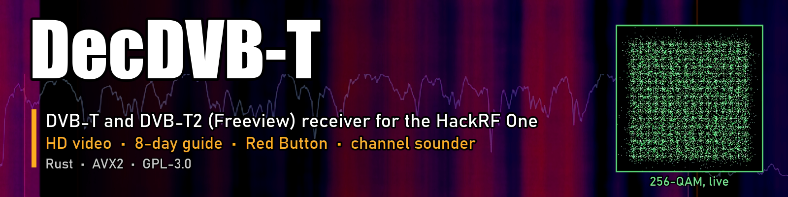
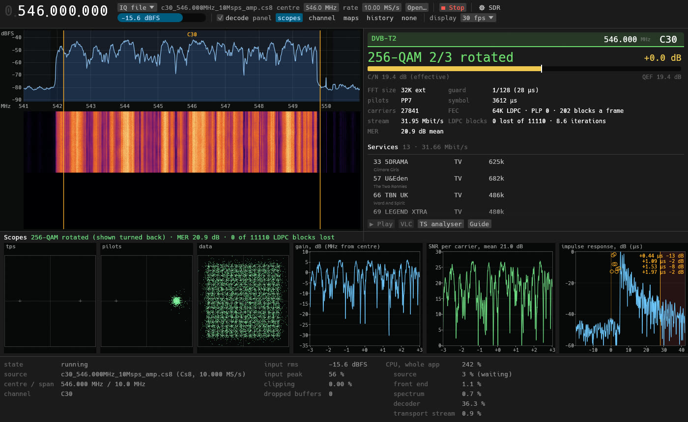
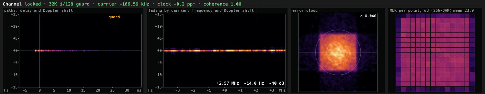
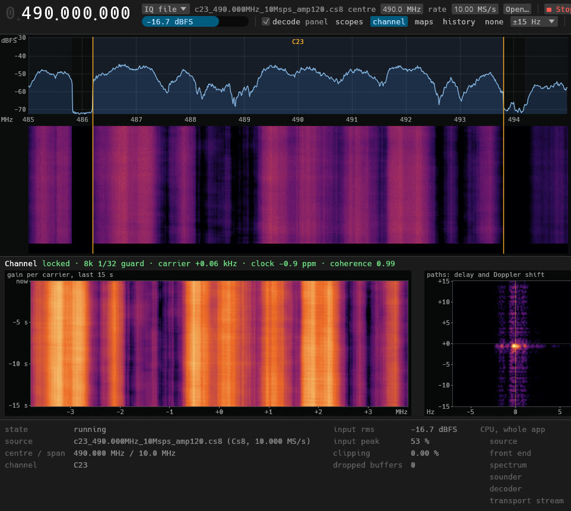

<p align="center">
  
</p>

<p align="center">
  <a href="https://github.com/CasualArclamp/DecDVB-T/releases/latest"></a>
  
  
  
</p>

**DecDVB-T** is a software-defined digital TV receiver. It takes raw radio
samples from a **HackRF One** or an **Airspy R2** (or an IQ recording) and does the whole job in
software: OFDM demodulation, equalisation, error correction, the transport
stream, the programme guide, video and audio, and the BBC's Red Button. It
receives both of the UK's Freeview standards, **DVB-T** and **DVB-T2** (the HD
multiplex), and shows you everything about the signal on the way.

It is written in Rust with hand-tuned AVX2 kernels, because CPU use is the
main requirement: a DVB-T multiplex decodes in about a third of one core, a
256-QAM DVB-T2 multiplex in about one.

## Features

**Reception**
- **DVB-T**: 2K and 8K, every guard interval, QPSK to 64-QAM, every code
  rate, read from the TPS. Viterbi and Reed–Solomon.
- **DVB-T2**: P1/P2 and L1 signalling, 1K to 32K (extended carriers), all
  pilot patterns, rotated constellations up to 256-QAM, 16K and 64K LDPC with
  BCH, time and cell deinterleaving. The FEC runs on its own threads and
  scales with the load.
- **Both at once**: the receiver locks to whichever standard is on the
  channel, follows the carrier and the radio's clock, and relocks after a
  fade.

**Watching**
- A built-in **player** (HD H.264 and SD MPEG-2 through ffmpeg) with sound,
  DVB subtitles and a choice of audio tracks.
- **BBC Red Button**: DSM-CC object carousels and a UK-profile **MHEG-5**
  engine. Red Button Text pages are drawn over the picture and work with the
  remote keys.
- An **8-day programme guide** for every channel on the network, Freeview's
  Huffman-compressed text decoded, with series, HD, subtitle, audio-description
  and signing marks and the guidance warnings.
- **Outputs**: the transport stream to a file, UDP or HTTP (VLC opens it).

**Seeing the signal**
- Spectrum and waterfall, a frequency dial, UHF channel tuning and a channel
  **scan** that says DVB-T or DVB-T2 and which mode.
- **Constellation scopes**, sharp and live, with a rotated T2 constellation's
  points put back on the grid.
- The **channel**: gain and SNR on every carrier, the impulse response and
  its echoes, a **channel sounder** with fading waterfalls and
  **delay–Doppler maps** (see each echo's delay and how fast it moves), heat
  maps of the channel over time, the error cloud and the MER of every
  constellation point.
- A **margin** worked out from the *effective* SNR (each carrier's capacity
  averaged), so a channel with deep notches does not look healthier than it
  decodes.
- A **transport stream analyser**: every PID, table, service and descriptor.

<p align="center">
  
</p>
<p align="center">
  
</p>
<p align="center">
  
</p>

## Getting started

1. **Hardware**: a HackRF One and a UHF TV aerial. Turn the HackRF's **RF amp
   on** for UHF TV: without it the signal is lost in the noise (the GUI's `amp`
   box, or `--amp --lna 32 --vga 8` on the command line).
2. **Driver** (Windows): bind the HackRF to the **WinUSB** driver (with
   [Zadig](https://zadig.akeo.ie/), or the driver the official HackRF tools
   install). DecDVB-T talks to it directly over USB: there is no libhackrf or
   libusb DLL to install.
3. **ffmpeg** for the player: `winget install Gyan.FFmpeg`. DecDVB-T finds it
   on the PATH, next to the exe, or in winget's folder.
4. Download `decdvbt-gui.exe` from the
   [latest release](https://github.com/CasualArclamp/DecDVB-T/releases/latest),
   run it, pick a channel and tick **decode**.

**Airspy R2 instead?** Bind it to the WinUSB driver the same way (USB ID
`1D50:60A1`), pick **Airspy R2** in the GUI's source list, or add `--radio
airspy` to `scan`, `capture` or `decode`. It has no RF amp switch: its gain is
three stages (LNA, mixer, VGA, 0–15) with libairspy's presets
(`--airspy-preset sensitivity:10`, `linearity:N`; `--airspy-lna/-mixer/-vga`
override single stages). It runs at 10 MS/s only. The driver is pure Rust like
the HackRF's, and the radio's real 20 MS/s stream is turned into IQ on the
host (about 4 % of a core). The Airspy front end is new and has not yet been
tried on the radio; see `docs/STATUS.md` for what is still to be checked.

No radio? The GUI and the CLI also read IQ recordings (8-bit complex `.cs8`
and others), and the CLI's `modulate` makes DVB-T and DVB-T2 test signals to
play with.

### Command line

```bash
decdvbt scan --amp --lna 32 --vga 8 --classify 5        # which channels carry a multiplex, DVB-T or T2
decdvbt decode C30 --amp --lna 32 --vga 8 -o c30.ts     # decode live to a transport stream
decdvbt decode capture.cs8 --guide 3                    # decode a recording and print the guide
decdvbt capture C23 --amp --lna 32 --vga 8 --record c23.cs8 --seconds 60
decdvbt decode C23 --radio airspy --airspy-preset sensitivity:10 -o c23.ts   # the same on an Airspy R2
decdvbt modulate --t2 uk --seconds 2.4 --cn 30 t2.cs8   # a DVB-T2 test signal through a simulated channel
```

### Transmitter (`decdvbt-tx`)

A second, separate program: `decdvbt-tx.exe` takes a **video file** and sends
it as **DVB-T** through the HackRF One (64-QAM 2/3 8k 1/32 by default, 24.13
Mbit/s; any DVB-T mode from 5 to 32 Mbit/s in the list). ffmpeg makes the
transport stream at exactly the channel's rate and the radio's sample clock
paces everything, so there is no buffer to drift. It is not a panel of the
receiver: it has its own window, its own settings (`%APPDATA%\DecDVB-T-TX\`)
and does not touch the receiver's.

```bash
cargo run --release -p decdvbt-tx-app                       # the window
decdvbt-tx clip.mp4 --mode 16qam-1/2-8k-1/32 --channel C30   # fills in the form; nothing starts
decdvbt-tx clip.mp4 --sink null --start --run-secs 30        # a real session into nothing: CPU and counters
decdvbt-tx --demo --state transmitting --screenshot tx.png   # a made-up status, no session at all
```

It is built so that transmitting is hard to do by accident and easy to stop:

- every start is **disarmed**, on the **test output** (nothing is sent), TX VGA
  0 dB and the RF amp off; none of those is remembered;
- the radio is reached by **PREPARE, then ARM** (tick that you have read the
  licence and attenuator warning, which is always on screen), **then
  TRANSMIT**. The arm lasts 60 s, is used up by one transmission and is
  dropped when the window loses focus for 5 s;
- while the radio is keyed the window has a red frame, a red TRANSMITTING
  banner and title, and **STOP** (also Esc or Space) is the largest control;
- the command-line hooks above can only reach the test output and an IQ file.

Connect the HackRF to a receiver through a cable and an **attenuator** (30 dB
or more) or a dummy load. Radiating on TV frequencies needs a licence, and the
UHF channels are in use: [`docs/TX_DESIGN.md`](docs/TX_DESIGN.md) has the
design and the safety model.

## Building from source

Install Rust (stable) with [rustup](https://rustup.rs/), then:

```bash
cargo build --release -p decdvbt-gui -p decdvbt-cli -p decdvbt-tx-app
cargo test --workspace
```

The exes land in `target/release/`. A release build runs on any x86-64 CPU
and picks the AVX2 code paths at run time when the CPU has them. Always use
`--release` for anything that touches signals: the DSP is far too slow
unoptimised.

| crate | what it does |
|---|---|
| `decdvbt-core` | shared types: modes, code rates, channels |
| `decdvbt-dsp` | filters, resamplers, DC and AGC |
| `decdvbt-io` | the HackRF and Airspy R2 (pure Rust over USB) and IQ files |
| `decdvbt-ofdm` | DVB-T and T2 pilots, interleavers, L1 signalling |
| `decdvbt-fec` | Viterbi, Reed–Solomon, LDPC (AVX2), BCH, the T2 demappers |
| `decdvbt-rx` | the receivers: acquisition, tracking, equalisers, the sounder |
| `decdvbt-ts` | transport stream: PSI/SI, the guide, DSM-CC carousels, outputs |
| `decdvbt-mheg` | the MHEG-5 engine for Red Button |
| `decdvbt-video`, `decdvbt-audio` | the player's ffmpeg pipeline and sound |
| `decdvbt-mod` | DVB-T and T2 modulators and channel models, for tests and the transmitter |
| `decdvbt-tx` | the transmit engine: ffmpeg, the rate-exact transport stream, the modulator, the arm gate, the sinks |
| `decdvbt-engine` | the receive thread that ties it together |
| `apps/decdvbt-gui`, `apps/decdvbt-cli` | the app and the `decdvbt` tool |
| `apps/decdvbt-tx` | the transmitter window (`decdvbt-tx.exe`, package `decdvbt-tx-app`) |

[`docs/DESIGN.md`](docs/DESIGN.md) has the design and
[`docs/STATUS.md`](docs/STATUS.md) the log of what was built and measured.

## Status

Tested on Windows 11 against UK Freeview multiplexes (DVB-T 64-QAM
and DVB-T2 256-QAM rotated). The code is portable Rust, but other platforms
have not been tried yet.

Not done yet: DVB-T2 MISO, FEF parts, T2-Lite, time interleaving over several
frames, and more than one PLP at a time (choosing one works); other radios
(the Airspy Mini, SDRplay, RTL-SDR).

## Credits

DecDVB-T follows the ETSI specifications (EN 300 744 for DVB-T, EN 302 755
and TS 102 831 for DVB-T2, EN 300 468 for SI). It borrows algorithms and
tables from GPL projects, credited where they are used in the code:
[gr-dtv](https://github.com/gnuradio/gnuradio/tree/main/gr-dtv) and Ron
Economos's DVB-T2 work, [MythTV](https://github.com/MythTV/mythtv) (the
Freesat/Freeview Huffman tables, and freemheg as the reference for the MHEG-5
engine), OnAir, and the author's own DecSAT and DecDRM. The HackRF driver is
FutureSDR's [`seify-hackrfone`](https://crates.io/crates/seify-hackrfone);
the Airspy R2's USB protocol and real-to-IQ conversion follow
[libairspy](https://github.com/airspy/airspyone_host) (BSD-3-Clause), over
[`nusb`](https://crates.io/crates/nusb); the GUI is [egui](https://github.com/emilk/egui).

## Licence

[GPL-3.0-or-later](LICENSE). DecDVB-T is a receiver for free-to-air
broadcasts. Its transmitter, `decdvbt-tx`, is a separate program that does
nothing until armed and then told to transmit, starts at the HackRF's lowest
power with the amp off, and is meant for a cable and attenuator into a
receiver: radiating on TV frequencies needs a licence.
